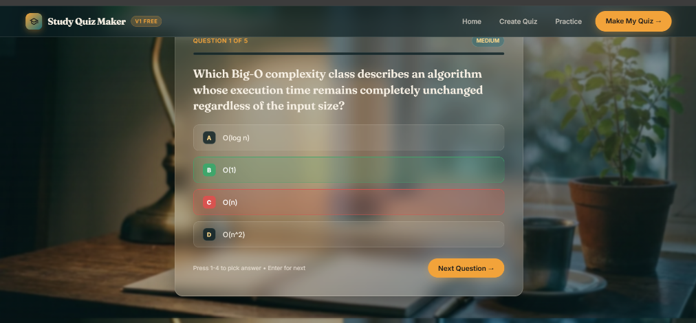

# Study Quiz Maker

Paste your study notes and get an AI-generated multiple-choice quiz with instant explanations.

**Live demo:** https://study-quiz-maker-gmmn.onrender.com
*(Free hosting: the first load after a quiet period can take about 30 seconds.)*



## What it does

1. Paste notes, a textbook summary, or a syllabus topic (20 to 6000 characters).
2. Choose 3 to 10 questions and a difficulty (easy, medium, hard).
3. Answer each question and get instant right/wrong feedback with an explanation.
4. See your score, review every answer, and retake the quiz or start with new notes.

## Features

- AI-generated multiple-choice questions with 4 options, the correct answer, and a short explanation
- Strict JSON output with validation and one automatic retry if the model's reply is malformed
- Server-side input validation and per-IP rate limiting
- Keyboard shortcuts: press 1 to 4 to pick an answer, Enter for the next question
- Demo mode with sample quizzes when no API key is set
- Responsive layout with a full-screen background image for each section

## Tech stack

- **Backend:** Python, FastAPI, Uvicorn, SlowAPI (rate limiting)
- **AI model:** Google Gemini (via the `google-genai` SDK), configured with environment variables
- **Frontend:** plain HTML, CSS and JavaScript (no framework)
- **Hosting:** Render free tier

## Run it locally

```bash
git clone https://github.com/shyam3112004/study-quiz-maker.git
cd study-quiz-maker

python -m venv venv
venv\Scripts\activate          # Windows
# source venv/bin/activate     # Mac/Linux

pip install -r requirements.txt
copy .env.example .env         # Windows (use cp on Mac/Linux)
```

Open `.env` and set your own values:

```
GEMINI_API_KEY=your_key_here
GEMINI_MODEL=your_model_name
RATE_LIMIT_PER_HOUR=10
MAX_NOTES_CHARS=6000
```

Then start the server:

```bash
uvicorn main:app --reload
```

Open http://127.0.0.1:8000. Without an API key the app runs in demo mode.

Never commit your `.env` file. It is listed in `.gitignore`.

## Project structure

```
study-quiz-maker/
├── main.py            # FastAPI app: /, /quiz, /health
├── requirements.txt
├── .env.example
├── static/
│   ├── index.html
│   ├── style.css
│   ├── app.js
│   └── assets/        # section background images
└── docs/              # project documents and screenshot
```

## About the AI model

This project currently runs on a Google Gemini model through its free tier. The backend is kept small and the model name comes from an environment variable, so other providers can be added later.

## Future ideas

- Add a Claude option so the app can run on either provider
- Tamil and English quiz language switch
- Upload a PDF of notes
- Save quiz history with sign-in
- Share a quiz by link

## Feedback

Built by Shyam, a final-year B.Tech AI & Data Science student. This is an early-stage personal project, and feedback or issues are welcome on GitHub.

## License

MIT
